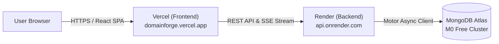

# 🚀 Free Cloud Hosting Guide: DomainForge AI

This guide walks you through deploying DomainForge AI 100% free using:
- **Frontend**: [Vercel](https://vercel.com) (Global CDN, automated CI/CD)
- **Backend**: [Render](https://render.com) or [Railway](https://railway.app) (FastAPI runtime + Server-Sent Events support)
- **Database**: [MongoDB Atlas](https://www.mongodb.com/atlas) (Free M0 512MB managed cloud database)

---

## 🏗️ Architecture Overview



---

## 🗄️ Step 1: Set Up Free MongoDB Atlas Cluster

1. Sign up or log in at **[MongoDB Atlas](https://www.mongodb.com/atlas)**.
2. Click **Create** and select the **M0 Free (Shared)** tier.
3. Choose your preferred cloud provider and region (e.g., AWS / us-east-1).
4. Under **Security Quickstart**:
   - Create a database user (e.g., username: `domainforge_admin`, password: `your_secure_password`).
   - Under **IP Access List**, add **`0.0.0.0/0`** (Allow access from anywhere, so Render/Railway can connect).
5. Click **Finish and Close**.
6. On the Database page, click **Connect** → **Drivers** (Python).
7. Copy your connection string:
   ```text
   mongodb+srv://domainforge_admin:<password>@cluster0.abcde.mongodb.net/?retryWrites=true&w=majority
   ```
   *(Replace `<password>` with your database user password).*

---

## ⚙️ Step 2: Deploy Backend to Render

1. Sign up or log in at **[Render](https://render.com)**.
2. In the Render Dashboard, click **New +** → **Web Service**.
3. Connect your GitHub repository: **`aeternum-core/domainforgeai`**.
4. Configure the Web Service settings:
   - **Name**: `domainforge-backend`
   - **Region**: Oregon (US West) or closest to your database
   - **Branch**: `main`
   - **Root Directory**: `backend`
   - **Runtime**: `Python 3`
   - **Build Command**: `pip install -r requirements.txt`
   - **Start Command**: `uvicorn server:app --host 0.0.0.0 --port $PORT`
   - **Plan**: `Free`
5. Scroll down to **Environment Variables** and add:
   | Key | Value |
   | :--- | :--- |
   | `MONGO_URL` | *Your MongoDB Atlas connection string from Step 1* |
   | `DB_NAME` | `domainforge` |
   | `PORT` | `10000` *(Render sets this automatically, but good to declare)* |
   | `GEMINI_API_KEY` | *(Optional) Your Google Gemini API Key for live LLM synthesis* |
   | `OPENAI_API_KEY` | *(Optional) Your OpenAI API Key* |
6. Click **Deploy Web Service**.
7. Once deployed, copy your public backend URL (e.g., `https://domainforge-backend.onrender.com`).
   - Verify by opening `https://domainforge-backend.onrender.com/api/` in your browser. You should receive `{"message":"DomainForge AI API","mode":"demo"}`.

> 💡 **Alternative: Railway**:
> 1. Go to [railway.app](https://railway.app) → **New Project** → **Deploy from GitHub repo**.
> 2. Select `aeternum-core/domainforgeai`.
> 3. In **Settings**, set Root Directory to `/backend` and add `MONGO_URL`. Railway will auto-detect the `Procfile` and deploy.

---

## ⚡ Step 3: Deploy Frontend to Vercel

1. Sign up or log in at **[Vercel](https://vercel.com)** with your GitHub account.
2. Click **Add New...** → **Project**.
3. Import **`aeternum-core/domainforgeai`**.
4. In the **Configure Project** screen:
   - **Project Name**: `domainforgeai` (or your chosen name)
   - **Framework Preset**: `Create React App`
   - **Root Directory**: Click **Edit** and select **`frontend`**
5. Expand **Environment Variables** and add:
   | Name | Value |
   | :--- | :--- |
   | `REACT_APP_BACKEND_URL` | *Your Render backend URL from Step 2 (e.g., `https://domainforge-backend.onrender.com`)* |
6. Click **Deploy**.
7. In ~60 seconds, Vercel will complete the build and assign your live production URL:
   ```text
   https://domainforgeai.vercel.app
   ```

---

## ✅ Step 4: Verification & Live Smoke Test

1. Open your live Vercel URL (e.g., `https://domainforgeai.vercel.app`).
2. Verify:
   - The top navigation bar shows the green **"Live Engine"** status badge.
   - The dashboard loads community agent templates from your cloud backend.
   - Open the **Urban Waterlogging Analysis Agent** workspace.
   - Run a workflow in the **Run** tab: confirm real-time step streaming (SSE), progress bars, and synthesis results load successfully.
   - Test publishing an agent: confirm the `/p/:slug` public link is live and shareable.

---

## 🔄 Automatic Continuous Deployment (CI/CD)

Whenever you push new commits to GitHub (`git push origin main`):
- **Vercel** automatically rebuilds and redeploys the frontend in seconds.
- **Render / Railway** automatically rebuilds and restarts the backend with zero downtime.
